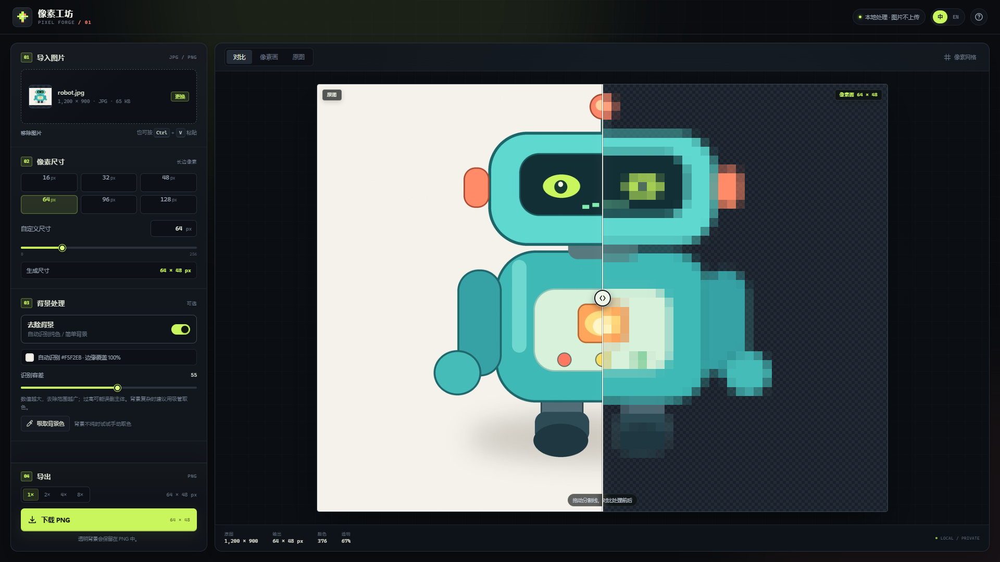

# 像素工坊 · Pixel Forge

把 JPG / PNG 照片转换成像素画。可自由选择输出像素尺寸、一键去除背景，并导出透明 PNG。

所有图片处理都在本机浏览器中完成，**图片不会上传，也不会联网**。

## 快速开始

1. 双击 **`启动像素工坊.bat`**。它会优先用 Edge 的独立应用窗口打开，也可以用默认浏览器；如果系统提示打开方式，直接双击 `index.html` 也可以。
2. 把你的 JPG / PNG 图片拖入页面，或点击「导入图片」选择文件。
3. 选择像素尺寸 → 按需开启「去除背景」→ 点击「下载 PNG」。

推荐使用较新的 Microsoft Edge 或 Google Chrome。应用不需要服务器，也不需要安装任何依赖。

## 功能

- **导入图片**：支持拖拽、点击选择，也可以按 `Ctrl + V` 直接粘贴剪贴板里的图片。单张最大 30 MB。
- **中英文切换**：右上角可一键切换中文 / English，并记住你的语言偏好。
- **像素尺寸**：预设 16 / 32 / 48 / 64 / 96 / 128 px，也可以自定义 8–256 px。尺寸表示最终图片的**长边像素数**，另一边按原图比例自动换算。
- **去除背景**：自动识别图片边缘的主要背景色，只移除与边缘连通的背景区域；可调「识别容差」。
- **吸管取色**：背景颜色不纯时，点击「吸取背景色」，再在预览中点击背景区域，精确指定要移除的颜色。
- **对比预览**：拖动中线对比原图和像素画；也可以切换到「像素画」或「原图」全屏查看。
- **像素网格**：开启后可以看清每一个输出像素的边界。
- **导出 PNG**：下载 1× / 2× / 4× / 8× 的 PNG；背景移除后的透明区域会保留。
- **快捷键**：`Ctrl + V` 粘贴图片，`Ctrl + S` 下载 PNG，`Esc` 取消吸管取色。

## 关于背景去除

自动去背景使用颜色识别，而不是云端 AI 抠图，因此更适合：

- 电商白底图、证件照、纯色背景的插画或角色图；
- 背景颜色与主体差异明显、边缘较硬的图片。

对于草地、街景、发丝、玻璃、半透明物体等复杂图片，结果可能不完美。可以：

- 调低容差，保留主体；
- 使用吸管点选主要背景色；
- 如果主体边缘仍有浅色残影，可提高容差后重新检查主体。

颜色越接近主体的背景，越难只靠颜色完全分离。这是本地轻量算法的取舍。

## 文件说明

| 文件 | 作用 |
| --- | --- |
| `index.html` | 应用主页面 |
| `styles.css` | 界面样式 |
| `app.js` | 图片处理与交互逻辑 |
| `favicon.svg` | 应用图标 |
| `启动像素工坊.bat` | Windows 快速启动脚本 |
| `preview.png` | README 使用的界面截图 |

## 技术说明

- 原生 HTML / CSS / JavaScript，无第三方运行时依赖，无网络请求。
- 支持中文 / 英文界面，语言偏好保存在浏览器本地。
- 图片读取、像素化、背景分割均通过 Canvas 在本机完成。
- 处理超大图片时会先将工作副本缩放到长边 2000 px，以保证交互速度；输出像素画仍按你选择的尺寸生成，不受此限制。
- 像素化使用面积加权平均和支持透明度预乘的颜色混合，尽量抑制背景色渗色。

---

像素工坊 / Pixel Forge · 在本地完成的像素艺术工作台
